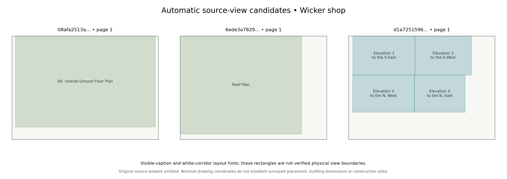

# Automatic drawing-view candidates

Area jobs can now prepare source-linked plan, elevation and section review packs
without hand-entered view rectangles. The stage reads visible native captions,
proposes row/column regions, renders each candidate from the original composited
PDF and retains whole source objects in nominal local coordinates.

This is automatic preparation for interpretation. Candidate rectangles can
include ground, context buildings, notes and legends. They do not authorize a
building assembly, geographic placement, physical dimensions or finished levels.



## Area configuration

```json
{
  "drawing_views": {
    "enabled": true,
    "max_pages": 16,
    "max_checks": 100000,
    "render_width": 800
  }
}
```

The setting is opt-in. It runs after evidence-directed acquisition and native
extraction, alongside architectural interpretation. The area report and full
sweep expose `drawing_views`. Content-addressed output under `drawing-views/`
contains `view-candidates.json`, a hash-bound `view-report.json`, and separate
`views/ID/view.png` and render receipts. Existing generation and acceptance
contracts remain separate.

`examples/wicker-automatic-drawing-views-job.json` combines the earlier automatic
acquisition with this stage. With no retained originals, it attempts the three
known checksum-pinned council attachments before preparing the pack:

```sh
python -m voxel_mapper.area_reconstruction \
  --job examples/wicker-automatic-drawing-views-job.json --stage extract

python -m scripts.audit_drawing_view_candidates \
  --job examples/wicker-automatic-drawing-views-job.json \
  --output output/wicker-automatic-drawing-views-audit.json
```

The audit reads original source objects, verifies whole-object lineage and
nominal coordinate round trips, checks crop/source hashes, and compares every
artifact against a fresh independently written pack. Original consultation PDFs
and their rendered review crops remain outside Git. The retained validation
receipts and artwork-free layout diagram are under `docs/evidence/drawing-views/`.

## Caption interpretation

The caption reader now supports ordinary unquoted existing/proposed claims,
diagonal cardinal elevation captions, and bounded site/block/location-plan
titles. Site/block/location titles are **sheet context**, without a verified
view rectangle. They cannot silently crop a map around its title block or supply
state to another view. Unsupported prose and contradictory state claims remain
withheld; floor, roof, elevation and section roles stay distinct.

Some CAD exports split a title into separately sized native fragments. The new
adapter checks the complete native text line and exact non-whitespace character
coverage. It requires the same native font name and direction, at most 16 fragments,
size ratio at most 1.02 and baseline disagreement at most 0.25 PDF points. Each
fragment retains its original trace/character references and is raster-screened
separately using the original font. No font size is normalized or substituted.
A hidden fragment withholds the combined caption. A recognized phrase inside
prose or a conflicting larger line cannot be published as a partial caption.
Budget failure withholds unchecked caption claims.

The caption layout contract advances to v3. Source title state, catalogue state
and a `PLANNING` label are not inherited as a view's construction state.

## Layout and nominal coordinates

Caption rows give candidate vertical bands. A composited grayscale raster, at
most approximately 1,800 pixels per side, finds white column corridors within a
band. Threshold 250, a three-pixel outer-border guard and a minimum eight-PDF-point
gap are fixed display heuristics. A uniquely widest eligible corridor separates
adjacent captions; ties or absent gaps withhold that row. Outer corridors can
exclude uncaptioned side panels. All separator evidence and raster hashes remain.
White space is not proof of a physical view boundary, and this is not a general
scanned-caption OCR adapter. Oblique native reading directions remain unsupported.

The raster check matters for drawings exported as full-page image tiles: their
placement boxes can cover blank gaps. Tile boxes are not treated as visible ink.
Images and vectors that cross a candidate boundary remain whole and unassigned;
no facade is manufactured by clipping a tile. Visible pixels in a review crop
remain source evidence rather than a new physical polygon.

A visible inline ratio, or one supported adjacent ratio, can supply a **nominal**
local transform. Duplicate adjacent ratios, conflicting ratios or absent view
scales leave the transform unavailable. A standalone page ratio does not fill
that gap. The local origin is a display-region corner, not a floor or survey
datum. Every source object keeps its original ID, canonical record hash and
unchanged native geometry; only unambiguous whole objects get a nominal copy.

## Limits and acceptance

Limits are 128 inspected pages, 20,000 retained objects per page, 100,000 layout
checks per page, 32 MB candidate data per page and 128 MB output per pack. Crop
widths are 200–1,600 pixels and retain the existing nine-million-pixel render cap.
Work-budget exhaustion removes partial view/membership assignments. Page-budget
exhaustion reports a partial inventory. Late rendering/output failures do not
publish a completed pack and may require a fresh output directory.

Source PDFs, feed hashes, implementation/dependency contracts and output artifacts
are checked on replay. Source or output edits cannot pass as accepted cached data.
The area contract is v5 and controller v3; use fresh work directories for older
jobs and retain previous worlds as pinned baselines.

The next geometry step is to establish which retained regions are actual building
boundaries and openings, reconcile plan/elevation dimensions and resolve view
state. Independent horizontal registration and vertical datum still gate park
insertion. Accepted physical components, new world blocks and AI training labels
remain **zero** for this source-view stage.

## Retained Alton validation

The three checksum-pinned Wicker shop sheets produce six candidates with no
supplied view rectangles: one ground-floor plan, one roof plan and four cardinal
elevations. All six have nominal 1:100 transforms; their per-view construction
states remain **unspecified**. Catalogue metadata is not substituted for printed
view evidence.

The audit checks 3,552 whole source objects (3,528 native vectors and 24 raster
placements). Another 31 crossing or competing objects are withheld whole, and
104 remain outside the candidates. All 13 artifacts match a fresh independent
pack, including the six original-source crops and their receipts.

On two ordinary site-plan sheets, the adapter recovers one existing-site title
from four original native fragments. The proposed-site caption remains
unsupported. Neither sheet receives a view crop from its title, and all 6,756
source objects stay outside candidates. The retained title proof includes the
original fragment references and glyph screens.

These checks used retained, checksum-verified originals offline. The example
job also enables the separately validated evidence-acquisition stage for a new
corpus; this view-stage validation did not perform a new council download.
See the two audit receipts and `local-validation.json` for source and test pins.
No physical component, geographic placement, world block or training label is
accepted by this stage.

The final local suite passes all **1,539 tests**, including 13 drawing-view tests.
