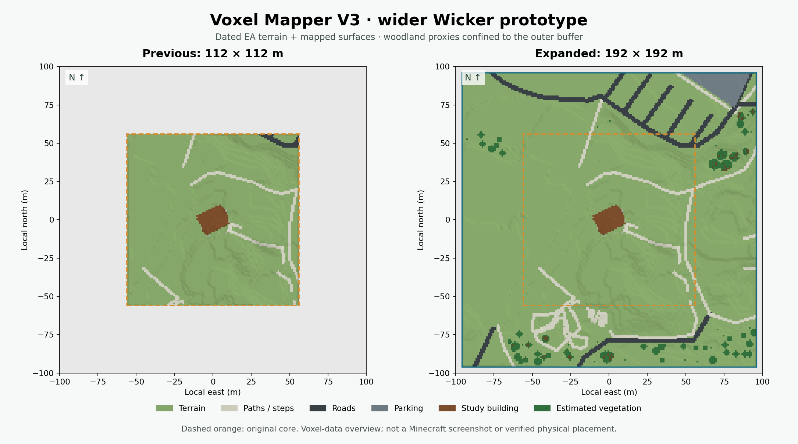

# Buffered site context

The new Wicker review jobs expand the same local scene from approximately
112 × 112 m to **192 × 192 m**, adding about 40 m of sourced terrain on each
side. They retain the building study and estimated access work, extend mapped
surfaces and add bounded woodland proxies outside the original core.



```sh
python -m voxel_mapper.world_pilot \
  --job examples/wicker-buffered-context-a-job.json \
  --output output/wicker-buffered-context-a

python -m voxel_mapper.world_pilot \
  --job examples/wicker-buffered-context-b-job.json \
  --output output/wicker-buffered-context-b
```

Install `.[planning]` and restore the three original PDFs as described in the
[component guide](provisional-component-review.md). Use fresh output directories.
Open `park.mcworld` in Minecraft Bedrock, follow `playtest-guide.md`, and edit a
copy of `playtest-results.json`. The generated form now also asks for terrain
transition and woodland/path-clearance observations. Every in-game check starts
as `not_run`. The prior user screenshot establishes that the earlier export
loaded and rendered; it is not a walkthrough of these expanded worlds.

## Sources and fixed coordinates

`docs/evidence/site-context/` retains the exact OSM API response, its normalized
elements, selected surface feed, acquisition receipt and native EA raster crops.
The EA DTM and DSM are from survey P_10682, dated 2022-01-05. Both crop windows
retain original one-metre BNG pixels and nodata with no interpolation or
resampling. The same pinned OSTN15 operation samples both products. This fixes
the foliage path's previous omission of the terrain's explicit horizontal
operation when opening its DSM.

The new optional config field `local_origin_wgs84` is a finite
`[longitude, latitude]` pair. It fixes the local azimuthal projection's origin
while the geographic bounding box changes. Without this field, builds retain
their existing bounding-box-centre default. The new jobs pin the original origin
`[-1.888781560340408, 52.98955563674633]`. A regression grows an asymmetric crop
over a non-flat raster and verifies that original terrain and feature cells keep
their coordinates and elevations.

To reproduce retention using the checksum-pinned original survey archives and
the retained map response:

```sh
python scripts/retain_wicker_buffer_context.py \
  --dtm-archive /absolute/path/dtm.zip \
  --dsm-archive /absolute/path/dsm.zip \
  --osm-map docs/evidence/site-context/osm-map.xml \
  --output /absolute/path/fresh-context-retention
```

The script requires the exact original EA archive and raster hashes, native
one-metre EPSG:27700 products, a complete window and matching OSM response bounds.
The retention receipt identifies the official source URLs and exact crops.
Reproduction is offline after these inputs are retained. OSM contributor
attribution and ODbL terms, and the Environment Agency OGL attribution, remain
in the registered sources and exported world's attribution file.

## Context contract

`review_context` requires an explicit provisional component review job and policy
`mapped-woodland-buffer-v1`. It pins the original core config, normalized OSM and
DSM, and names registered OSM/surface source IDs. It requires the original core
origin and datum and an expanded bounding box covering that core. Normal
`world-pilot-v1` jobs cannot enable this estimated context.

The adapter reuses the existing foliage generator against a temporary, verified
native occupancy snapshot. The snapshot is removed before publication. Woodland
proxies stay in the outer terrain buffer, outside a two-metre guard around the
original core; every complete emitted cell must remain in that domain. Existing
mapped surfaces, structures, native occupancy and headroom masks constrain
placement. Both terrain and canopy use the pinned datum operation. The final
combined world is exported and read back again with the existing access checks.

The example permits at most 64 trees and 100,000 context cells, within the
unchanged one-million pilot voxel and four-million native composition budgets.
The adapter's limits are 128 trees and 100,000 cells. Canopy centres within
mapped woodland, branches, crown widths, shrubs and unspecified species remain
visual estimates. A DSM-minus-DTM envelope is not a vegetation classifier or
an individual tree survey. No planning or AI-training acceptance follows.

## Retained result

The 32 mapped surface inputs produce **1,695 path, 1,518 road and 1,044 parking
voxel records** in each scene. Nine elevated/tunnel features remain withheld
without absolute base levels. The three woodland outlines support **15 estimated
trees, 32 shrub clusters and 22 groundcover plants**, totalling 3,014 context
records. Terrain coverage grows from 12,544 to **36,864 columns**, with no missing
terrain samples. Overlapping records can share a final composed block.

All 12,544 original terrain heights, all 993 study-building records and the
existing access records are preserved. One original boundary cell at local
`[29, 182, 55]` now receives mapped road paving as the wider road crosses the old
crop edge; its ground height stays unchanged. Woodland adds no core geometry.
The lower minimum terrain in the expanded area changes the export's vertical
offset from -113 to **-111**, so native Y values move up two blocks while source
heights remain unchanged. Artificial foundations extend two metres deeper; they
remain display supports, not measured subsurface geometry. The new native spawn
is **`[11, 71, 3]`**.

Hypothesis A retains complete native walkthrough routes through all three
entrances. Hypothesis B retains its two broad-entrance routes; the northwest
exterior route remains unresolved under the bounded rule. Geometry is unchanged
by that unresolved status. Both alternatives retain unverified orientation,
source-to-building identity, floor/datum and materials. The ranker remains an
untrained baseline with zero real reviewed labels and zero accepted real
planning components.

The larger sourced buffer moves the terrain joins away from the test building.
It does not eliminate finite crop boundaries: Minecraft may generate unrelated
terrain outside the exported chunks. Additional park coverage remains necessary
for a continuous full-park landscape. See the retained validation receipt under
`docs/evidence/site-context/` for replay, hashes, native/core comparisons and tests.
