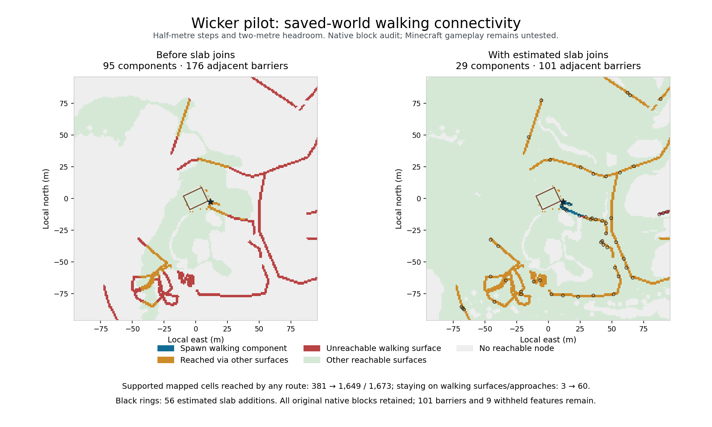

# Estimated path slab joins

These additional review jobs add small display steps to the existing 192 × 192 m
Wicker scene. They retain the terrain, source paving, building and entrance
approaches. Each new bottom stone slab occupies an empty block above grounded
mapped paving, raising that cell's walking surface by 0.5 m. Its neighbouring
upper cell provides the second half step. These are estimated display joins;
the source data does not establish surveyed steps or a real access design.

```sh
python -m voxel_mapper.world_pilot \
  --job examples/wicker-path-steps-a-job.json \
  --output output/wicker-path-steps-a

python -m voxel_mapper.world_pilot \
  --job examples/wicker-path-steps-b-job.json \
  --output output/wicker-path-steps-b
```

Install `.[planning]`, restore the three original PDFs following the
[component guide](provisional-component-review.md), and use fresh directories.
The jobs reuse the exact terrain, DSM, mapped inputs, coordinate operation and
component evidence from the [whole-area audit](whole-area-navigation.md).
Native spawn stays `[11, 71, 3]` with source-to-world Y offset `-111`.

## Retained results

Each hypothesis adds **56** native bottom stone slabs. The two cold package
comparisons cover **30,670,848 native cell pairs** and confirm that all other
cells, including every original terrain and building block, are unchanged.
Original source voxel records remain byte-identical after filtering out the
new additions. All 1,673 surviving mapped pedestrian cells retain support;
the same 18 overridden cells remain separately reported.

| Native diagnostic | Before A | Before B | New A | New B |
| --- | ---: | ---: | ---: | ---: |
| Walking-surface components | 95 | 95 | 29 | 29 |
| Adjacent barriers under the half-step rule | 176 | 176 | 101 | 101 |
| Supported mapped cells reached by any walking route | 381 | 536 | 1,649 | 1,649 |
| Mapped cells reached while staying on walking surfaces/approaches | 3 | 3 | 60 | 60 |
| Complete exterior-to-interior entrance witnesses | 3 | 2 | 3 | 3 |



The broader reachability result may use grass, roads or interior surfaces; it
does not establish continuous mapped paving. Each new on-surface sample is
29 m, while its separately labelled terrain detour is 252 m. B's northwest
entrance now has a 25 m exterior spawn-to-interior witness; other doors are not
used as shortcuts. The source narrow-door raster approximation remains.

Independent checks verified **754 native route points** across ten witnesses
and all nonzero adjacent standing-height gaps around the new slabs. No such
gap was enlarged, including adjacent grass. The full suite passed **1,495 tests**
after tightening that guard. Geometry and audit files reproduce exactly in
fresh runs of both jobs. Receipts under `docs/evidence/path-steps/` retain
world hashes, cell/route checks, source preservation and tested code hashes.

The 101 remaining barriers, 24 supported mapped cells unreachable under this
rule, 18 overridden cells and nine withheld bridge/tunnel features remain
explicit findings. No missing bridge/tunnel geometry is supplied. Physical
placement, floor datum, as-built identity and materials remain unverified.

## Selection and guards

The policy is explicit and confined to provisional review jobs:

```json
{
  "review_component": {
    "access": {
      "policy": "estimated_each_opening_approach_v2",
      "audit_scope": "whole_pilot",
      "path_steps": {
        "policy": "estimated_half_slab_joins_v1",
        "max_slabs": 128
      }
    }
  }
}
```

This fragment belongs alongside the existing pinned component inputs. Unknown
settings, non-integer limits, limits outside 1–512, and a neighbourhood-only
audit reject the job before output. Existing jobs omit `path_steps` and keep
their geometry. Candidate work is bounded to 4,096 columns, plus the existing
pilot input, area, readback and graph limits.

Only surviving full-block pedestrian paving at an emitted terrain surface is
eligible. Both ends must be grounded, and the new block position must be absent
from the composed input. Spawn, every constructed approach column, and the
building footprint plus a one-metre guard are protected. Low ceilings, occupied
cells, unsupported shapes and missing terrain prevent a join.

The selector grows the spawn walking component first, then prefers joins that
merge more components and larger groups. Coordinate order resolves ties. Upper
endpoints are locked at their original heights so later slabs cannot undo a
join. Every previously usable incident walking edge must survive. No existing
nonzero height gap to an adjacent standing surface may become larger, including
off-path grass; previously flat edges may become half steps. Consecutive steep
rises can therefore remain wholly unresolved. This bounded greedy selection
does not establish an optimal or complete stair/ramp layout.

Original voxel records are retained in order. The native composer keeps every
original block, with slabs added only in previously empty cells. Each slab
carries its original mapped feature and cell reference, explicit display policy
and `accepted_physical_geometry: false`. The audit recognizes a raised mapped
cell only when that reference matches the surviving source record and the saved
native slab has bearing support and headroom. A generic step block cannot make
missing or overridden paving count as supported.

## Native checks and gameplay

`path-steps-review.json` records original and raised heights, selected source
cells, native block positions, before/planned/native connectivity and protected
edges. After vegetation generation, the existing whole-area reader reopens the
native world. Every join, original incident edge, nonzero adjacent height gap,
supported mapped cell and previously reachable mapped cell is checked again.
A failed check prevents delivery and removes the failed native world/package.
The result is hashed in `pilot-report.json` and embedded in the world quality
report. The conservative collision model still uses known full blocks/slabs,
cardinal movement, two metres of headroom and at most half-metre steps.

Import `park.mcworld` in Bedrock and follow `playtest-guide.md`. The world opens
in Creative; use the provided spawn reset and Adventure commands to test walking
without flight or jumping. The world-bound blank form includes a separate slab
join check. Inspect joins in both directions, entrance routes and remaining
barriers. All human results start `not_run`; native checks do not complete an
in-game test or verify real-site accuracy.

## Independent comparison and replay

The cold-check script extracts the packaged worlds into fresh temporary
directories. It compares every native cell across all emitted chunks through
the full -64…319 build height, including air, and permits only the reported
air-to-bottom-slab changes. It also checks source-row retention, unchanged
component data, pinned inputs, native waypoints/support/headroom, exterior
entrance prefixes, adjacent height gaps, artifact checksums, pending gameplay
forms and byte-identical replay of deterministic geometry/audit files.

```sh
PYTHONPATH=. python scripts/validate_wicker_path_steps.py \
  --before output/wicker-area-navigation-a \
  --after output/wicker-path-steps-a \
  --replay output/wicker-path-steps-a-replay \
  --output output/path-step-cold-check-a.json
```

Repeat with hypothesis B. Package bytes may vary between fresh exports; each
walkthrough/form binds to its own world hash. No source floor, orientation or
physical acceptance is inferred from these checks. The ranker remains an
untrained baseline and no training labels are created.
