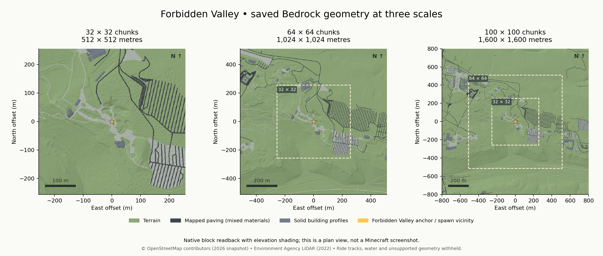
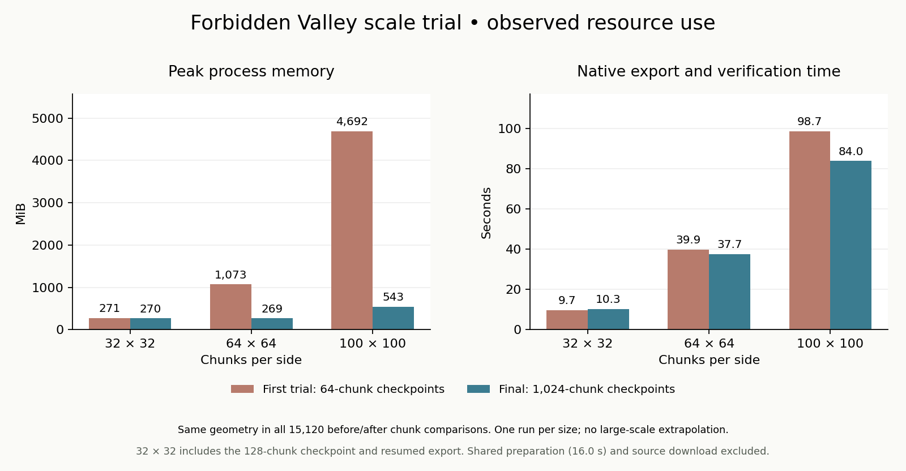

# Forbidden Valley scale trial

Three dense Bedrock exports cover **Forbidden Valley and surrounding Alton
context**, using real one-metre terrain, mapped paving and DSM building
profiles. The largest contains **10,000 chunks over 1.6 × 1.6 km**. Every saved
chunk passes full-height material comparison, with no missing chunks.



## Measured results

| Chunks per side | Total chunks | Metres per side | Solid blocks | Export/check/package | Peak process RSS | World ZIP bytes |
| --- | ---: | ---: | ---: | ---: | ---: | ---: |
| 32 × 32 | 1,024 | 512 | 5,028,923 | 10.30 s | 270.3 MiB | 282,465 |
| 64 × 64 | 4,096 | 1,024 | 19,885,284 | 37.66 s | 269.0 MiB | 1,068,306 |
| 100 × 100 | 10,000 | 1,600 | 48,121,274 | 83.97 s | 542.9 MiB | 1,534,475 |

These are single-run observations in the recorded Linux/Python workspace,
not device performance guarantees. Shared input preparation took **15.97 s**;
source downloads and the later independent cold validation are outside the
export timer. The 32 × 32 result sums a 128-chunk checkpoint and its resumed
export; its memory figure is the higher peak of those two processes. Peak RSS
can include source preparation. Solid blocks exclude air, and include the
artificial foundations. The compact ZIPs reflect repeated block palettes and
LevelDB compression; file size does not measure geometric detail.

The first trial exposed memory growth during repeated native database opens.
A minimal key-enumeration diagnostic retained roughly 27 MiB more resident
memory after each close, despite Python garbage collection. The final exporter
reads directly through the native format wrapper and checks batches of at most
1,024 chunks, reducing repeated database scans. The 100 × 100 observed peak
fell from **4,691.6 to 542.9 MiB**, and 64 × 64 from **1,072.7 to 269.0 MiB**.
All **15,120** before/after chunk hashes remain identical. This bounds the trial
size and working tile, but does not establish constant memory at arbitrary
world sizes or fix the underlying LevelDB binding's allocation behavior.



## Real inputs and geometry limits

The anchor is OSM **Forbidden Valley node 674445842**, at longitude/latitude
`[-1.88309, 52.9866941]`, snapped to the BNG chunk grid at
`[407952, 343264]`. The largest retained bounds are
`[407152, 342464, 408752, 344064]` in EPSG:27700. A pinned regional OSTN15
grid places the fresh OSM snapshot on the dated terrain.

The paired EA rasters identify survey **P_10682, 2022-01-05**, tile SK0540.
Terrain covers all **2,560,000 columns**, ranging from 92.946 to 194.851 m ODN.
DSM finite coverage is **98.7898%**; its gaps remain gaps. The OSM snapshot
was acquired on **2026-10-16**. The four-year source mismatch is material around
changed attractions and buildings; neither source establishes current as-built
geometry. All original input SHA-256 pins and source URLs are in the job and
[source receipt](evidence/forbidden-valley-scale/source-selection-2026-10-16.json).

The common largest-domain compilation emits 569 mapped display features:
75 building profiles, 188 paths, 271 roads, 12 plazas, 13 parking features,
seven steps and three cycleways. These are source-feature counts, not distinct
physical-object counts. Another 203 features are withheld, in addition to the
OSM parser's unsupported attraction/track records. The detailed
[compile report](evidence/forbidden-valley-scale/compile-report.json) records
each decision, material assumption and skipped source feature.

Paths/plazas follow sampled terrain with mapped material tags and explicit
default widths/materials when tags are absent. These are OSM polygons and
buffered ways; the Wicker planning drawing geometry is not copied into this
area. Steps do not have measured treads. Building geometry uses the existing
DSM coverage/height/roughness gates and produces **solid unverified 2.5D
profiles** within mapped footprints, without interiors, detailed roofs or
themed facades. Bridges, tunnels and nonzero layers lack absolute elevation
evidence and remain withheld. Water levels/depths, ride tracks/mechanisms,
vegetation, detailed theming and unbound planning objects are not invented.

Native X increases east, native Z increases south; samples are block centres
`E = anchorE + X + 0.5`, `N = anchorN - Z - 0.5`. The shared vertical offset
is **-28 blocks**, and spawn is **`[0, 150, 0]`** in all stages. The artificial
foundation starts 16 blocks below each chunk's minimum sampled ground. It
does not represent surveyed subsurface geology or a full solid Earth column.
One 16 × 384 × 16 tile is rendered at a time; full-world voxel dictionaries
are not allocated. Sparse overlay cells are indexed in SQLite.

## Restart and independent saved-world checks

The 32 × 32 trial stops after 128 verified chunks, closes the process, resumes
those chunks from native storage and writes the other 896. A final fresh-process
resume rechecks all 1,024, writes **zero** new chunks and reuses the unchanged
published package. Partial checkpoints never produce a `.mcworld`.

Before committing a chunk as ready, the exporter records its source-rendered
intent, writes native data, closes and reopens the database, and compares every
material including air. Unit tests interrupt between native flush and ready
commit to verify recovery; changed inputs/renderings, missing ready chunks and
saved material corruption reject resume. Chunk readback is exact under the
declared translated material properties, not merely a highest-block check.

The separate validator extracts each immutable `.mcworld` into a fresh directory
and checks archive CRC, package/embedded contract, spawn metadata, complete chunk
coverage, materials throughout Y **-64…319**, and native spawn bearing/headroom.
It compares the prepared terrain to the original raster and independently
checks **816,467 unmodified chunk-boundary columns** against that source.
All **1,024** small-to-medium and **4,096** medium-to-large overlapping chunks
have identical geometry hashes. In total, **1,486,356,480 native cell positions**
are cold-checked; this includes air and is not a generated solid-block count.
The [cold receipt](evidence/forbidden-valley-scale/cold-validation.json) and
[measurements](evidence/forbidden-valley-scale/measurements.json) retain the
exact world checksums. The previews use top surfaces read from those packages.

The full local suite passes **1,515 tests**. Seven added tests cover native
material/air round trips, restart recovery, corrupted saved blocks, input
changes, strict budgets, real GeoTIFF/XML processing, explicit source withholding
and asymmetric terrain coordinates across all quadrants. Existing pipelines
and scheduler limits remain unchanged.

## Reproduce

From the repository root, install `.[planning]` as usual. Restore only the
checksum-matching dated raster originals, then use a fresh output root:

```sh
python -m scripts.restore_scale_trial_inputs \
  --job examples/forbidden-valley-scale-job.json

python -m voxel_mapper.scale_trial \
  --job examples/forbidden-valley-scale-job.json \
  --output output/forbidden-valley-scale --chunks 32 --chunk-limit 128

python -m voxel_mapper.scale_trial \
  --job examples/forbidden-valley-scale-job.json \
  --output output/forbidden-valley-scale --chunks 32

python -m voxel_mapper.scale_trial \
  --job examples/forbidden-valley-scale-job.json \
  --output output/forbidden-valley-scale --chunks 64

python -m voxel_mapper.scale_trial \
  --job examples/forbidden-valley-scale-job.json \
  --output output/forbidden-valley-scale --chunks 100

python -m scripts.validate_scale_trial \
  --job examples/forbidden-valley-scale-job.json \
  --output output/forbidden-valley-scale
```

Repeat the 32-chunk command to produce `resume-check.json` without changing the
original package. Preparation artifacts, job/input pins and the two new renderer
module hashes are bound to the saved contract. Use fresh output after any code
or source change. Fresh LevelDB packages can have different metadata/ZIP bytes;
compare native chunk geometry rather than expecting identical new world ZIPs.
No coarse, synthetic or newer-raster fallback is used by the restore script.

Plotting is separate from generation and requires `matplotlib`:

```sh
python -m scripts.plot_scale_trial \
  --trial output/forbidden-valley-scale \
  --measurements docs/evidence/forbidden-valley-scale/measurements.json \
  --output output/forbidden-valley-scale/figures
```

The retained measurements describe this recorded run. For a new benchmark,
record new measurements rather than reusing them as new performance evidence.

## Human review and next scale gate

Import each supplied `stage-N/park.mcworld` in Bedrock, follow its
`playtest-guide.md`, and fill in a copy of the world-hash-bound
`playtest-results.json`. All human checks remain **`not_run`**. Check spawn,
walk mapped paving, fly across chunk boundaries and the exported perimeter,
then save/reopen and record device/frame-rate observations. Native checks do
not certify collision physics, whole-area walking connectivity, visual fidelity
or client streaming performance.

**1,500 × 1,500 chunks has not been tested.** That is 24 × 24 km and 2.25 million
chunks, spanning far beyond Alton Towers. This opt-in trial stops at 10,000
chunks, and the existing scheduler's 262,144-chunk cap is unchanged. The next
scale gate is a recorded client test of the 100 × 100 world, then a deliberate
larger-area input/height/budget plan and isolated native database checkpoints
before increasing these bounds. Do not extrapolate the timing or memory table
linearly to that request.

Accepted planning components and generated training labels remain **zero**.
The AI ranker remains an untrained baseline. Automatic planning-to-geometry,
independently verified placement/levels, detailed rides and client acceptance
are separate remaining prototype blockers.
