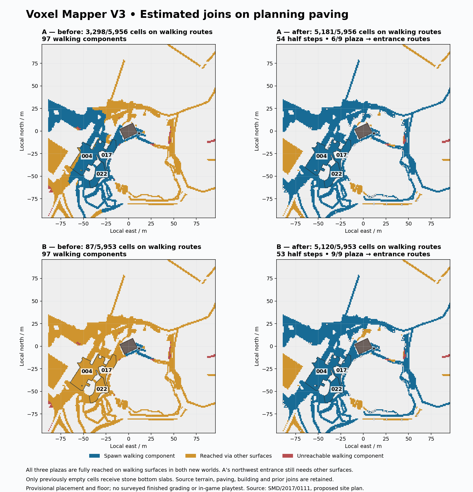

# Estimated joins on planning paving

The additional jobs connect isolated full-block rises on the
[recovered planning paving](planning-paving-review.md). They add **54 bottom
stone slabs in A and 53 in B**, in previously empty cells. The terrain, source
paving, building, original mapped supports and previous 56 slab joins remain.
These are prototype display transitions, not surveyed site steps or grading.

All three supported plaza footprints are now reachable from spawn while staying
on walking surfaces in both orientations. The stricter plaza-to-entrance check
finds **six of nine routes in A and all nine in B**. A's northwest door still
needs other surfaces. Neither orientation is promoted as physically correct.



## Generate and replay

Install `.[planning]` and restore the pinned originals following the
[paving guide](planning-paving-review.md) and
[component guide](provisional-component-review.md). Use fresh output directories:

```sh
python -m voxel_mapper.world_pilot \
  --job examples/wicker-planning-paving-joins-a-job.json \
  --output output/wicker-planning-paving-joins-a

python -m voxel_mapper.world_pilot \
  --job examples/wicker-planning-paving-joins-b-job.json \
  --output output/wicker-planning-paving-joins-b
```

The opt-in job setting is:

```json
{
  "review_surface_steps": {
    "policy": "estimated_planning_paving_joins_v1",
    "max_slabs": 128
  }
}
```

It requires a planning surface review and whole-pilot native audit. Unknown
settings, missing surface review, non-integer limits or limits outside 1–512
reject the job. Existing jobs omit this setting and retain their geometry.
The component selector is shared with the prior mapped-path join policy;
its original behavior remains covered by the existing tests.

## Selection and preservation

Only source-linked, surviving planning paving at an emitted terrain height is
eligible. A full walking block at the lower end receives one bottom slab,
raising its walking surface by 0.5 m toward an existing upper walking cell.
The new block must be absent from the composed scene, with sufficient headroom.
The stone material is an explicit display choice, not a printed specification.

Spawn, constructed approaches, prior entrance witnesses and the building plus
a one-metre guard are protected. Original mapped cells are never raised by this
second policy. Every earlier slab and its adjacent checking columns remain
fixed. A candidate with any lower neighbouring standing surface is withheld;
every existing walking edge and nonzero adjacent standing-height gap must
survive. Missing paving, ungrounded surfaces, occupied blocks, low ceilings and
consecutive steep rises do not receive inferred connections.

The bounded greedy selector grows the spawn walking component first, then
prefers more merged components and their size. Stable coordinate order breaks
ties. Upper endpoints are locked so later selections cannot undo earlier joins.
At most 4,096 candidates are evaluated against the slab limit. This does not
establish an optimal or complete ramp layout.

Original source rows remain byte-identical, including planning finishes and
vegetation. Each new slab binds to its exact source paving feature/cell and
PDF hash/page. The saved-world reader checks its actual material, source
lineage, bearing, headroom, upper connection and preservation guards. A generic
slab cannot make an unsupported planning footprint count as supported. Failed
native checks prevent delivery and remove the failed native world/package.

## Proposed levels stay separate

`planning-paving-levels-review.json` retains **22 literal plus-level claims and
three FFL claims** from the same original proposed site-plan PDF. It records
their source text boxes, annotation positions, containing-polygon candidates
and provisional local positions. The plus glyph supplies an annotation point;
it does not independently verify a surveyed spot marker. Multiple containing
polygons and absent candidates remain explicit. Floor text positions do not
establish building anchors or verified floor roles.

The plan includes shop text **FFL 182.5**, while the study world retains its
unverified **184 m** review floor. The report retains printed/terrain/floor
differences as diagnostics. It applies **zero absolute finished levels**, no
offset, interpolation, terrain regrade or floor change. Proposed annotations,
dated terrain and an estimated study floor do not establish a common verified
datum or current as-built surface. Independent source identity and level-marker
association are still required before using these claims for grading.

## Native walking results

| Diagnostic | Before A | After A | Before B | After B |
| --- | ---: | ---: | ---: | ---: |
| Planning paving cells reached on walking surfaces | 3,298 | 5,181 | 87 | 5,120 |
| Mapped cells reached on walking surfaces | 536 | 1,397 | 60 | 1,397 |
| Walking components | 97 | 36 | 97 | 38 |
| Adjacent barriers under the half-step rule | 577 | 491 | 581 | 497 |

All 1,673 original mapped supports remain at their existing walking heights.
Planning supports remain 5,956 in A and 5,953 in B, with 54/53 walking heights
raised by half a metre. Native spawn stays `[11, 71, 3]`, offset `-111`.

| Plaza | Supported cells | A reached on walking surfaces | B reached on walking surfaces |
| --- | ---: | ---: | ---: |
| `004`, existing paving | 719 | 719 | 719 |
| `017`, existing paving | 214 | 214 | 214 |
| `022`, proposed new paving | 277 | 277 | 277 |

Each plaza retains a spawn-to-plaza witness. From its final point, the new
plaza-to-entrance checks restrict the exterior prefix to walking surfaces and
the named opening columns. They then continue to the declared interior floor.
The nine combinations are tested separately: A's northeast/southwest routes
are ready for all three plazas, while all three northwest combinations are
unresolved. B has all nine native witnesses. No terrain detour is reclassified
as a paved entrance connection. Each world also keeps the three original
spawn-to-interior witnesses, whose route scope can include other surfaces.

There are still 21 planning paving cells and 24 supported mapped cells per
world unreachable even using other surfaces under this rule. Other cells may
require off-path walking. The 18 overridden mapped cells, nine withheld
bridge/tunnel features, steep runs and disconnected components remain explicit.

## Validation and human walkthrough

The full suite passed **1,508 tests**. New tests cover native job replay, source
lineage, original mapped/slab/entrance guards, lower adjacent terrain, headroom,
strict policies and a deliberately wrong saved slab material with the same
bearing height. An extreme `+999.0` source claim remains unapplied. A separate
test confirms that an otherwise walkable grass gap cannot pass the paved
plaza-to-entrance check.

Independent cold comparisons reopen both packaged worlds and compare
**30,670,848 native cell pairs** through the full -64…319 build height.
Exactly 107 previously empty cells become bottom stone slabs; **all original
native blocks remain unchanged**. Source rows, component reports, paving polygon
files and input assets remain identical. Every source walking support is checked
in the saved database, along with **197 nonzero adjacent height gaps** and
**2,797 route points across 31 witnesses**. None of those height gaps grows.
Fifteen deterministic geometry/audit files match fresh runs. Artifact hashes,
embedded reports and world-bound blank gameplay forms are checked.

Receipts are under `docs/evidence/paving-joins/`. After generating a fresh
second export, repeat the comparison with:

```sh
PYTHONPATH=. python scripts/validate_wicker_paving_joins.py \
  --before output/wicker-planning-surfaces-a \
  --after output/wicker-planning-paving-joins-a \
  --replay output/wicker-planning-paving-joins-a-replay \
  --output output/paving-join-cold-check-a.json
```

Repeat for B. Import each `park.mcworld` in Bedrock and follow its
`playtest-guide.md`. Walk the joins in both directions without jumping, follow
the plaza and entrance routes, and fill in a copy of `playtest-results.json`.
All human results remain `not_run`; native checks are not an in-game physics
test or physical acceptance. Accepted planning components and training labels
remain zero, and the AI ranker remains an untrained baseline.

The next geometry target is A's northwest paved connection and the remaining
steep/disconnected surfaces. Verified grading still needs independent level
identity/datum evidence. A recorded Bedrock walkthrough remains the next
prototype acceptance check.
