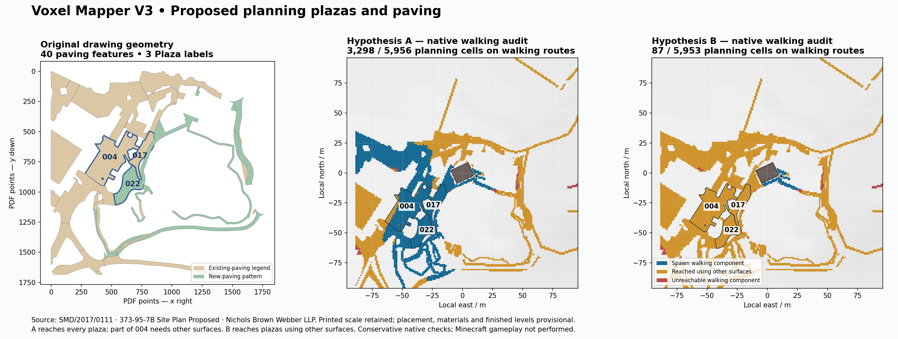

# Planning plazas and paving in the review worlds

The additional Wicker jobs recover paving outlines from the retained original
proposed site plan and add them to both 192 × 192 m review worlds. They retain
source references, holes, drawing scale and the existing terrain heights.
This is provisional review geometry; independent placement, finished levels,
as-built state and a trained production model remain unresolved.



## Source and replay

The drawing is **373-95-7B Site Plan Proposed showing Woodland path**, page 1,
Nichols Brown Webber LLP, application **SMD/2017/0111**. Its source URL and
explicitly unverified state are pinned in
[`source-record.json`](evidence/planning-surfaces/source-record.json).
The original PDF SHA256 is
`1c5dc5b43ddf14de2d0b96d7970cee8197d115c46d6919ad74aa484c77a61a1d`.

Restore that exact original to
`retained-source-input/wicker-surfaces/files/<sha256>.pdf`, outside Git.
The council attachment is linked in the source record. A missing or changed
original rejects the job. Reuse status remains unconfirmed; public access is
not a licence claim. This change does not include the original PDF in Git.
Also restore the three shop originals following the
[component review guide](provisional-component-review.md), and install
`.[planning]`. From the repository, use fresh output directories:

```sh
python -m voxel_mapper.world_pilot \
  --job examples/wicker-planning-surfaces-a-job.json \
  --output output/wicker-planning-surfaces-a

python -m voxel_mapper.world_pilot \
  --job examples/wicker-planning-surfaces-b-job.json \
  --output output/wicker-planning-surfaces-b
```

These jobs extend the [56-slab review](estimated-path-step-joins.md). The terrain,
DSM, mapped sources, OSTN15 crop, origin, study building, estimated floor and
existing access approaches retain their pinned inputs. Native spawn stays
`[11, 71, 3]` with source-to-world Y offset `-111`.

## Drawing recovery and provisional placement

The extractor associates native filled paths with the **Existing Paving with
levels** swatch and native PDF patterns with **New Paving with levels**. It
excludes legend/title artwork and 17 text masks. Curved fill/clip edges use
bounded cubic subdivision with a maximum 0.05 m chord tolerance at printed
scale. A self-crossing even-odd fill contains the third plaza: its original
edges are noded, polygonized and classified using the PDF's ray-crossing
parity. No snapping, buffer repair or hull construction supplies its outline.
Unsupported paths and patterns remain reported as withheld.

The result is **40 source footprints and all three Plaza labels**, with no
unmatched Plaza labels. Of these, 37 intersect this pilot and 36 own emitted
cells after clipping and protection rules. Full source/local outlines remain
available even for features without emitted cells. This is a supported paving
subset, not an inventory of every physical object in the area.

The placement keeps the printed scale fixed at **0.08820209736232452 m per PDF
point**. Rotation and translation are selected from four shop-corner
orientations, checked against named mapped track geometry and 14 uniquely near
track annotations. A free-scale fit is recorded only as a diagnostic; it is
not applied. The named shop and track provide a provisional map-agreement
hypothesis, not independent survey controls. Both worlds use this same plan
pose while retaining their separate building-orientation hypotheses.

## Composition and materials

Only supported terrain/pedestrian surface cells are eligible. Roads, parking,
the study building footprint and blocked/buried surfaces are protected. Cell
centres must lie inside the recovered polygon, including its holes. Proposed
footprints take precedence over existing footprints, followed by labelled
plazas, printed brick labels and stable source order.

The layer changes the finish at the existing terrain elevation. It does not
excavate, raise terrain or apply unbound spot levels as finished paving levels.
Existing source rows remain byte-identical. Each mapped surface that receives
a planning finish keeps its original feature/cell reference, including the
reference supporting an existing half slab above it.

Printed brick annotations are distinguished from display rules. Other plazas
and new paving reuse the retained Wicker brick display rule; unspecified
existing paving uses the retained stone palette. These choices do not claim
that an existing/new-paving legend specifies constituent materials. Every
review row records the PDF hash/page, estimated origin and
`accepted_physical_geometry: false`. Material bases are in the source/local
GeoJSON. Estimated buffer vegetation excludes the new walking footprints and
their one-metre guard; twelve tree proxies remain instead of fifteen.

## Native results and remaining gaps

| Diagnostic | A | B |
| --- | ---: | ---: |
| Planning paving cells with verified native materials | 5,956 | 5,953 |
| Terrain finishes replaced at unchanged heights | 5,642 | 5,639 |
| Mapped pedestrian finishes with retained source references | 314 | 314 |
| Original mapped supports retained | 1,673 | 1,673 |
| Planning paving cells reachable by any walking route | 5,888 | 5,885 |
| Planning paving cells reached while staying on walking surfaces | 3,298 | 87 |
| Mapped cells reached while staying on walking surfaces | 536 | 60 |

The previous walking-only mapped reach was 60 cells in each world. The unchanged
1,649 mapped cells reachable by any walking route may use terrain, roads or
interior surfaces. Broader reachability does not establish continuous paving.

| Plaza footprint | Supported cells | A on walking surfaces | B on walking surfaces |
| --- | ---: | ---: | ---: |
| `004`, existing paving | 719 | 643 | 0 |
| `017`, existing paving | 214 | 214 | 0 |
| `022`, proposed new paving | 277 | 277 | 0 |

All supported cells in each plaza are reachable using other surfaces when
needed. A has walking-surface spawn-to-plaza witnesses of 64, 34 and 73 m;
the 64 m witness reaches part of plaza 004, while 76 of its cells still need
other surfaces. B's witnesses are 83, 42 and 101 m and explicitly use other
surfaces. Each scene also retains all three exterior-to-interior entrance
witnesses. The guide records separate plaza and entrance checks; it does not
claim one continuous paved route through every plaza cell and entrance.

The expanded surface graph has 97 components and 577/581 adjacent barriers.
Those totals include thousands of newly represented paving cells, so they are
not a like-for-like regression comparison with the earlier mapped-only graph.
There are still 24 supported mapped cells and 68 planning paving cells per
world unreachable under the conservative rule, plus 18 overridden mapped
cells and nine withheld bridge/tunnel features. No bridge/tunnel geometry is
invented. Terrain-following paving exposes full-block height changes; it does
not solve their real finished-level design.

## Verification and human playtest

The full suite passed **1,502 tests**. New tests exercise native PDF recovery,
holes, road protection, source lineage, curved/crossing fills, missing or
ambiguous map references, bounded policies, pending forms and a deliberately
wrong saved paving material with unchanged bearing height. A foliage test
checks that a new walking mask withholds a whole tree rather than leaving
disconnected upper parts.

Independent cold checks reopen both packaged worlds and compare
**30,670,848 native cell pairs** across all 156 chunks per scene through
Y = -64…319. Only paving finishes and 257 estimated vegetation cells per
scene change. There are no native changes outside those categories. Every
paving material, all 1,673 original mapped supports per scene and **1,292
route points across 16 witnesses** are checked. Building/source/slab rows and
the component report remain byte-identical. Thirteen deterministic geometry
and audit files match fresh runs. All output hashes and embedded paving
reports are checked; package bytes may vary between exports.

Receipts are in `docs/evidence/planning-surfaces/`. To repeat the independent
comparison after generating a fresh second output:

```sh
PYTHONPATH=. python scripts/validate_wicker_planning_surfaces.py \
  --before output/wicker-path-steps-a \
  --after output/wicker-planning-surfaces-a \
  --replay output/wicker-planning-surfaces-a-replay \
  --output output/planning-paving-cold-check-a.json
```

Repeat for B. Import each `park.mcworld` in Bedrock and follow its
`playtest-guide.md` without flight or jumping. Every human result in
`playtest-results.json` remains `not_run`, bound to that exact package hash.
Native checks do not establish in-game physics or real-site correctness.

The next geometry work is evidence-based finished levels and connecting
transitions, followed by a recorded in-game plaza/entrance walkthrough.
Independent placement, the unverified 184 m review floor, as-built/reuse
qualification and omitted bridge/tunnel evidence remain separate blockers.
Accepted planning components and training labels stay at zero; the ranker
remains an untrained baseline.
