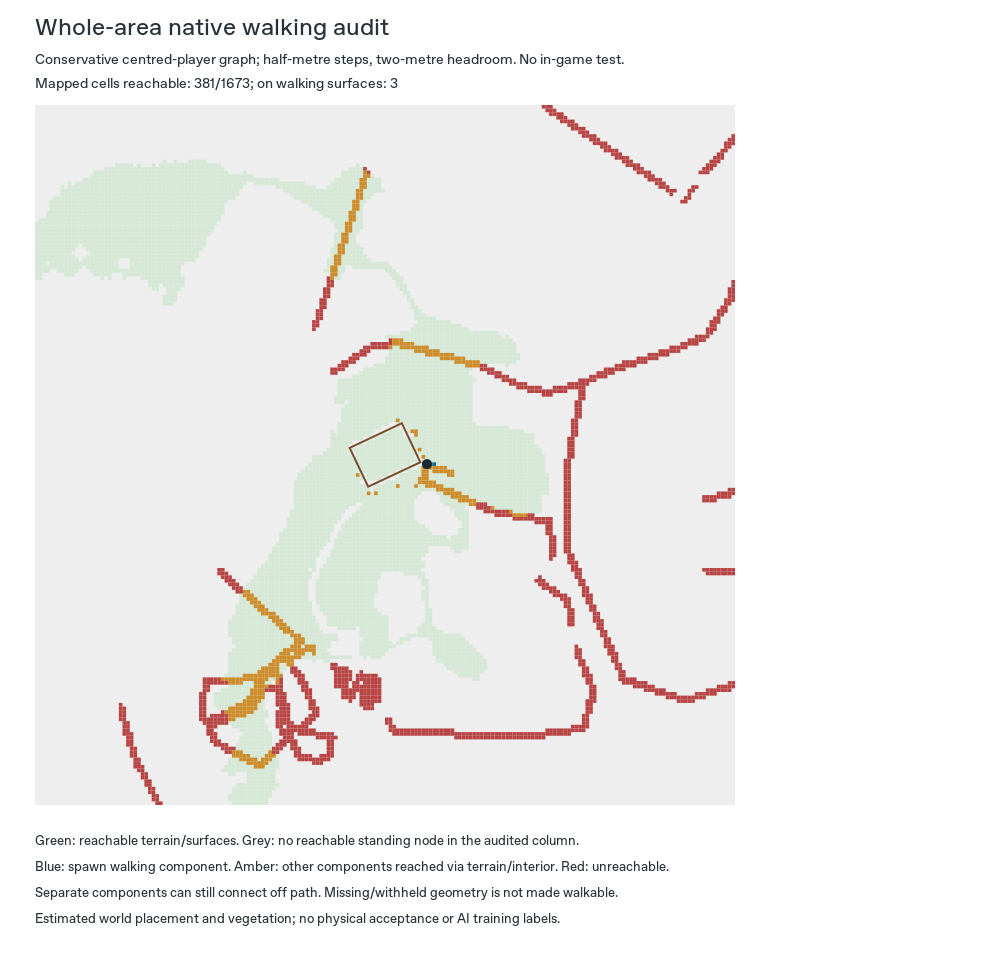

# Whole-area navigation

The new review jobs check the full 192 × 192 m emitted scene. Earlier entrance
audits used a roughly 65 × 65 m neighbourhood. Approach construction keeps its
existing 32 m radius and work limits; widening the audit does not add geometry.

```sh
python -m voxel_mapper.world_pilot \
  --job examples/wicker-area-navigation-a-job.json \
  --output output/wicker-area-navigation-a

python -m voxel_mapper.world_pilot \
  --job examples/wicker-area-navigation-b-job.json \
  --output output/wicker-area-navigation-b
```

Restore the same three original PDFs described in the
[component guide](provisional-component-review.md), install `.[planning]` and use
fresh output directories. Open `park.mcworld` in Bedrock, read
`playtest-guide.md`, inspect `navigation-review.svg` and edit a copy of
`playtest-results.json`. Native spawn remains `[11, 71, 3]`.

## Scope and interpretation

Set `review_component.access.audit_scope` to `whole_pilot` alongside an existing
estimated approach policy. The default remains `component_neighbourhood`.
Unknown scopes/fields reject the job. The native reader re-inventories the
final voxel feed after context generation and reads all emitted columns from
the saved world, with a 40,000 bounding-column limit, one-million block-read
limit and the existing 60,000-state graph limit. Chunks are read one at a time.

The simplified player uses cardinal movement, known bearing blocks, two metres
of headroom and at most half-metre steps. No jumping or flight is simulated.
Unknown shapes obstruct movement. This is a conservative diagnostic, not the
Minecraft physics engine. A full-block step is an obstacle under this rule even
when a player could jump it in-game.

Two reachability results are kept separate:

* **Any walking route:** may cross terrain, roads or the building interior.
* **Walking surfaces only:** stays on surviving mapped pedestrian surfaces and
  explicitly estimated approach steps. It cannot use grass or the interior to
  make disconnected paving appear continuous.

Entrances still require their own exterior spawn-to-crossing witness and a route
onto the interior floor. A general terrain/interior connection never replaces
that entrance-specific proof. A synthetic saved-world test proves an exterior
route outside the old radius, then blocks it in the actual saved world and
verifies that the result becomes unresolved.

The audit also fixes equal-priority mapped aliases. Native composition retains
the first record at a junction, but the old path lookup replaced it with the
last. Its equality check could then hide the surviving shared cell. The lookup
now follows the same priority and tie rule; genuinely overridden cells remain
excluded.

## Reports and walkthroughs

`navigation-review.json` retains walking-surface components, per-feature
supported/reachable/overridden counts, adjacent step/headroom barriers, missing
input IDs and up to two representative route witnesses. Witnesses start at
spawn, use native block centres and retain fractional feet heights. Each sample
is capped at 512 points; graph counts cover the complete bounded audit.

The SVG marks reachable terrain in green, the spawn walking component in blue,
other components reachable through terrain/interior in amber, and unreachable
components in red. Grey columns have no reachable standing node under the rule.
Different surface components can still connect off path. Withheld geometry is
listed separately and cannot become an audited passage.

The walkthrough includes a short on-surface sample and a longer explicitly
labelled off-path sample, with native waypoints. Its blank form adds site-route
and whole-area-obstacle checks, tied to the exact world SHA256. All human checks
remain `not_run`. The reports and SVG are hashed in `pilot-report.json`; the
same navigation result is embedded in the packaged world's quality report.

## Retained findings

Both hypotheses retain byte-identical `voxels.jsonl` data to the buffered-context
iteration. There are 1,691 distinct selected pedestrian cells: 1,673 survive
composition and 18 are overridden. Both have **95 walking-surface components**
and **176 adjacent barriers**, all full-block steps exceeding the half-metre
rule. These findings identify a display-quantization problem; widening the
audit does not repair it or establish a continuously paved park route.



| Result | A | B |
| --- | ---: | ---: |
| Supported pedestrian cells reachable by any walking route | 381 / 1,673 | 536 / 1,673 |
| Reachable while staying on walking surfaces/approaches | 3 | 3 |
| On-surface sample length | 2 m | 2 m |
| Off-path sample length | 147 m | 197 m |
| Resolved entrance walkthroughs | 3 | 2 |

A retains all three entrance routes. B's northwest exterior route remains
unresolved even with wider coverage. The long off-path examples do not certify
continuous paving or a route around the exterior of every entrance. Minecraft
playtesting of these jobs remains pending. The next geometry problem is source-
preserving pedestrian step/ramp representation, with explicit display changes
and native movement checks; it cannot be solved by relabelling the audit green.

## Nine withheld features

The new config exposes the already retained, checksum-pinned DSM to the existing
bridge candidate checks, using the same OSTN15 operation as the DTM. No candidate
qualifies and no deck or tunnel geometry is added:

* `osm/way/107026704`: the 19.412 m footbridge fails the transverse 0.75 m surface
  variation check after nine samples. Rails/canopy or deck identity remain
  unresolved; the check is not relaxed.
* `osm/way/453986307` and `osm/way/453986308`: complete bridge footprints/endpoints
  cross the build boundary. Clipped spans cannot establish a complete deck.
* Six tunnel features retain unknown absolute floor/base levels. An above-ground
  DSM cannot supply those levels from a `layer=-1` tag.

`bridge-qualification-2026-10-16.json` under `docs/evidence/area-navigation/`
retains the source-bound decisions. The validation receipt records replay,
native route checks, scope coverage and tests. Physical placement, floor datum,
as-built identity and materials remain provisional. No real training labels are
created and the ranker remains an untrained baseline.
